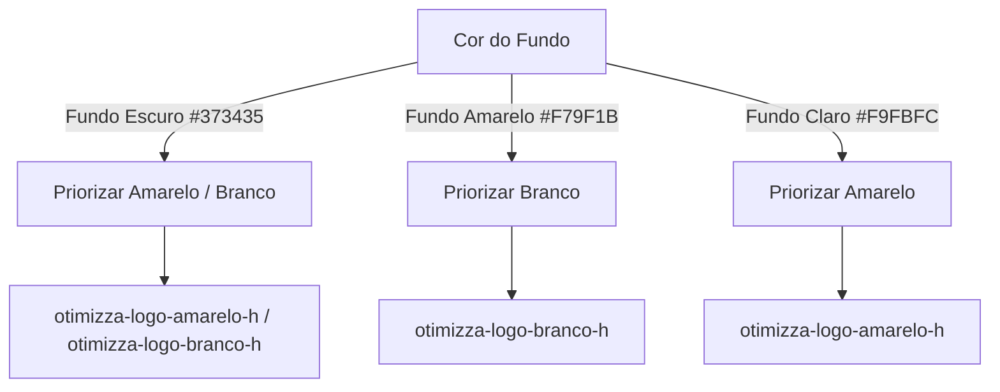

# Manual de Branding — Otimizza SaaS CRM

Este documento serve como a especificação técnica e de design para a identidade visual da **Otimizza**, o sistema SaaS multivertical que engloba três CRMs exclusivos e personalizados:
1. 🏠 **Imobiliárias**
2. 🚗 **Loja de Veículos**
3. 📱 **Loja de Celular**

---

## 🎨 Paleta de Cores

A paleta de cores da Otimizza foi projetada para transmitir dinamismo, tecnologia e solidez. É composta por três cores principais de marca:

| Tipo | Amostra | Nome do Tom | Código Hex | Aplicação Recomendada |
| :--- | :---: | :--- | :--- | :--- |
| **Principal** | 🟧 | Amarelo Otimizza | `#F79F1B` | Destaques, CTAs primários, botões de ação e ícones de marca. |
| **Secundária**| ⬛ | Escuro Otimizza | `#373435` | Textos principais, fundos de cabeçalho, painéis escuros e contraste. |
| **Terciária** | ⬜ | Claro Otimizza | `#F9FBFC` | Fundos gerais do sistema, áreas de conteúdo e contrastes suaves. |

---

## 📐 Diretrizes de Uso e Contraste

Para garantir a legibilidade e a harmonia estética da interface em todas as telas, devem ser seguidas as regras de contraste descritas abaixo:

> [!IMPORTANT]
> **Regra Geral de Contraste:**
> - **Em fundos escuros (`#373435`):** Use a variação do logo na cor oposta, priorizando o **Amarelo (`#F79F1B`)**.
> - **Em fundos amarelos (`#F79F1B`):** Priorize a logo **Branca**.
> - **Em fundos brancos/claros (`#F9FBFC`):** Priorize a logo **Amarela**.
> - *Nota:* Salvo em condições de design especiais explicitamente aprovadas.

### 🌐 Uso do Avatar
O avatar é utilizado primariamente para identificação na barra superior do navegador (como favicon) ou em cabeçalhos compactos de perfil. O avatar pode possuir fundo colorido ou transparente conforme a tabela de ativos.



---

## 🗂️ Mapeamento de Ativos (Assets)

Os arquivos de imagem e logotipos estão catalogados conforme o padrão abaixo:

### 1. Logotipos Horizontais (Fundo Transparente)
Ideais para barras de navegação (navbars), cabeçalhos principais e rodapés largos.

* **Amarela:** `otimizza-logo-amarelo-h`
* **Escura:** `otimizza-logo-preto-h`
* **Clara:** `otimizza-logo-branco-h`

### 2. Logotipos Verticais (Fundo Transparente)
Ideais para telas de login, cartazes digitais, menus laterais abertos e telas de carregamento (splash screens).

* **Amarela:** `otimizza-logo-amarelo-v`
* **Escura:** `otimizza-logo-preto-v`
* **Clara:** `otimizza-logo-branco-v`

### 3. Ícones Isolados (Fundo Transparente)
Perfeitos para botões compactos, marcadores de página, favicons simples e marca d'água.

* **Amarelo:** `otimizza-icon-amarelo`
* **Escuro:** `otimizza-icon-preto`
* **Claro:** `otimizza-icon-branco`

### 4. Avatares (Ícones com Fundo Sólido)
Utilizados para imagens de perfil padrão, favicons avançados de abas de navegador e badges do sistema.

| Nome do Arquivo | Cor do Ícone | Cor do Fundo | Contexto de Uso |
| :--- | :--- | :--- | :--- |
| `otimizza-avatar-am-br` | Escura | Amarelo | Destaques vibrantes em cabeçalhos claros ou cinzas |
| `otimizza-avatar-am-pt` | Clara | Amarelo | Elementos de alto contraste em barras amarelas |
| `otimizza-avatar-br-pt` | Escura | Claro | Minimalismo em áreas claras e dashboards limpos |
| `otimizza-avatar-br-am` | Amarela | Claro | Visual moderno e sutil em fundos brancos |
| `otimizza-avatar-pt-am` | Amarela | Escuro | Visual premium e noturno com destaque de marca |
| `otimizza-avatar-pt-br` | Clara | Escuro | Discreto e sóbrio em temas escuros integrados |

---

## 💻 Integração Técnica

Para facilitar o desenvolvimento dos três CRMs (Veículos, Imóveis e Celulares), utilize as seguintes definições prontas no código:

### CSS Variables (`index.css` ou similar)
Adicione as variáveis abaixo na raiz do seu arquivo CSS global:

```css
:root {
  --otimizza-primary: #F79F1B;
  --otimizza-secondary: #373435;
  --otimizza-tertiary: #F9FBFC;
  
  /* Cores derivadas para hover e transparências */
  --otimizza-primary-hover: #e08b10;
  --otimizza-secondary-hover: #262425;
  --otimizza-primary-alpha10: rgba(247, 159, 27, 0.1);
}
```

### Configuração do Tailwind (`tailwind.config.js`)
Para incorporar as cores diretamente como classes do Tailwind (ex: `bg-otimizza-primary`, `text-otimizza-secondary`), adicione a seguinte extensão na chave `theme.extend.colors`:

```javascript
// Adicionar dentro de theme.extend.colors na sua configuração do Tailwind:
otimizza: {
  primary: '#F79F1B',
  'primary-hover': '#e08b10',
  secondary: '#373435',
  'secondary-hover': '#262425',
  tertiary: '#F9FBFC',
}
```

---

## 🏢 Divisões do SaaS (Os 3 CRMs)

Cada um dos CRMs possui características visuais alinhadas com a marca mãe **Otimizza**, aplicando variações para contextualizar a experiência do usuário:

* **🏠 CRM Imobiliárias:** Foco em layouts limpos e elegantes. O uso da cor terciária `#F9FBFC` é predominante nos planos de fundo para destacar fotos de imóveis de alta resolução. O amarelo `#F79F1B` é usado para sinalizar o status de "Disponível", "Vendido" ou ações prioritárias de proposta.
* **🚗 CRM Loja de Veículos:** Combina a robustez da cor secundária `#373435` para criar um visual moderno/esportivo de showroom digital, usando o amarelo para detalhes de ofertas, quilometragem e botão de WhatsApp.
* **📱 CRM Loja de Celular:** Foca em uma interface rápida, dinâmica e mobile-first, com elementos baseados em cards modernos com bordas arredondadas e ícones bem desenhados, destacando especificações dos smartphones.
