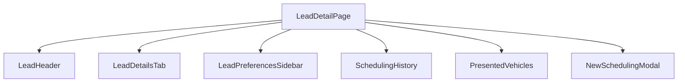

# Code Review & Refactoring Design (LeadDetailPage.tsx)

Date: 2026-07-10
Status: Draft

---

## 1. Context & Identified Antipatterns

The component [LeadDetailPage.tsx](file:///c:/Sistemas/Orvalho%20Digital%20-%20Ve%C3%ADculos/src/pages/LeadDetailPage.tsx) is a major monolithic component of **991 lines**. Under the `code-reviewer` and `clean-code` standards, we identify the following issues:

### Monolithic State and Rendering
The file contains all business logic for scheduling visits, handling notes, showing presented vehicles, managing modals (Visit Scheduling, Send Message, Disqualification, Simulation), and rendering the full tabbed UI.

### Low Reusability
Subcomponents like the presented vehicle selection card, visit item cards, and scheduling forms are defined inline and cannot be reused elsewhere (e.g. in the dashboard or active kanban board).

### Direct Supabase Client Calls
Some mutations and fetches bypass services, making it harder to test or modify database integrations.

---

## 2. Proposed Refactoring Strategy

We will break the page down into a main page container and modular subcomponents:

### Components to Extract:
1. **`LeadHeader`:** Name, temperature, phase badges, quick actions (call, email, WhatsApp, edit, disqualified).
2. **`LeadPreferencesSidebar`:** Temperature tracker, vehicle/moto interest tags, target price range, custom parameters.
3. **`PresentedVehicles`:** Carousel or list of vehicles presented, matching vehicles list, and recommended matches.
4. **`SchedulingHistory` & `NewSchedulingModal`:** List of visits with appointment card items, updates notes timeline, and the scheduling modal.

---

## 3. Next Steps Selection

Would you like to proceed with this subcomponent extraction for [LeadDetailPage.tsx](file:///c:/Sistemas/Orvalho%20Digital%20-%20Ve%C3%ADculos/src/pages/LeadDetailPage.tsx) to make it clean, maintainable, and aligned with Phase 2?

1. **Yes, extract subcomponents**: Refactor the file by extracting header, sidebar, presented vehicles, and scheduling components.
2. **Focus on another file first**: Refactor a different large file (like `Dashboard.tsx` or `Inventory.tsx`).
3. **Skip and go to Phase 3 (Security/Backend Audit)**: Keep the component as-is and focus on database and security audit.
